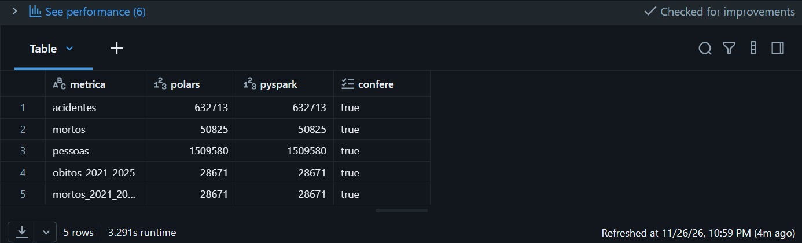

# Onde se morre nas rodovias federais

**[Ver a análise interativa com o mapa ↗](https://maribarbalho.github.io/acidentes-rodovias-federais/)**

Nove anos de boletins de acidentes da Polícia Rodoviária Federal (2017 a 2025) tratados em um **pipeline medalhão** que roda em duas engines: **Polars**, localmente, e **PySpark no Databricks**, com tabelas Delta no Unity Catalog. As duas versões chegam exatamente aos mesmos totais. A análise responde onde, quando e por que os acidentes matam, e quais trechos pedem intervenção primeiro.

O projeto evolui um exercício de Polars do curso de Big Data (Senai), que lia três planilhas anuais, para um case completo com ingestão automática, camadas de qualidade, duas engines e visualização publicada.

## Principais resultados

| | |
|---|---|
| Acidentes registrados (2017–2025) | **632,7 mil** |
| Mortos no período | **50,8 mil** |
| Mortos a cada 100 acidentes | **7,0 em 2017 → 8,3 em 2025**: menos acidentes, mais letais |
| Causa que mais mata (2021–2025) | **Transitar na contramão**: 4.163 mortos, 37,4 a cada 100 acidentes |
| Noite × dia | **11,5 × 6,1** mortos a cada 100 acidentes |
| Pista simples × dupla | **11,9 × 5,2** |
| Área rural × urbana | **11,0 × 4,9** |
| Horário com mais mortes | **domingo, 19h** |
| Óbitos de motociclistas (2021–2025) | **32%** dos 28.671 óbitos |

**Leitura:** a colisão frontal em pista simples, de noite e em trecho rural concentra a letalidade. Duplicação e separação de fluxos, uma lista objetiva de trechos críticos (no mapa) e fiscalização no fim de semana à noite são as alavancas mais diretas. As recomendações estão na página.

## Arquitetura

```
PRF (dados abertos, Google Drive oficial)
   │  src/rodovias/ingest.py          18 ZIPs: ocorrências e pessoas por causa e tipo, SHA-256 registrado
   ▼
BRONZE  CSV latin-1, ";" e decimal com vírgula      632.713 ocorrências · 4.070.595 linhas de pessoas
   │  src/rodovias/pipeline.py  (Polars)   ou   databricks/pipeline_pyspark.py  (PySpark + Delta)
   ▼
SILVER  tipos, padronização, flags de qualidade      1 linha por acidente · 1.509.580 pessoas únicas
   ▼
GOLD    série, causas, condições, hora × dia, trechos de 10 km, UFs, grade do mapa, vítimas
   ▼
docs/data/rodovias.json (150 KB)  ──►  docs/index.html  (Observable Plot, GitHub Pages)
```

### Polars × PySpark

O mesmo desenho foi escrito nas duas engines. A última célula do notebook do Databricks compara os totais com os da versão local e só passa se todos forem iguais:



| Métrica | Polars | PySpark (Databricks) |
|---|---|---|
| Acidentes | 632.713 | 632.713 |
| Mortos | 50.825 | 50.825 |
| Pessoas únicas | 1.509.580 | 1.509.580 |
| Óbitos 2021–2025 (arquivo de pessoas) | 28.671 | 28.671 |
| Mortos 2021–2025 (arquivo de ocorrências) | 28.671 | 28.671 |

As duas últimas linhas também reconciliam os dois arquivos da PRF entre si: cada morto registrado na ocorrência aparece como pessoa em estado "Óbito".

## Qualidade dos dados: o que a camada silver resolve

| Problema encontrado nos arquivos da PRF | Tratamento |
|---|---|
| Arquivos em latin-1, separador `;`, decimal com vírgula e `NA` como nulo | Leitura explícita e conversão de tipos |
| 5 ids exportados em notação científica (`1e+05`) | Conversão via float; sem isso, 4 acidentes se perdiam no dedupe |
| Arquivo de pessoas repete cada pessoa para cada causa e tipo do acidente (4,07 mi linhas → 1,51 mi pessoas) | Uma linha por pessoa, a da causa principal |
| Lista de causas ampliada ao longo de 2020 (24 causas em 2017, ~70 desde 2021) | Análises por causa e condição só em 2021–2025 |
| Traçado da via com vários valores a partir de 2024 (`Reta;Declive`) | Fica o primeiro valor |
| 53 coordenadas fora do território | Marcadas (`coord_valida`) e fora do mapa |
| Idades impossíveis | Viram nulo |

## Como reproduzir

Requer Python 3.11 ou superior e cerca de 2 GB livres (os CSVs descompactados).

```powershell
git clone https://github.com/maribarbalho/acidentes-rodovias-federais.git
cd acidentes-rodovias-federais
python -m venv .venv
.venv\Scripts\activate            # Linux/Mac: source .venv/bin/activate
pip install -r requirements.txt

$env:PYTHONPATH = "src"           # Linux/Mac: export PYTHONPATH=src
python -m rodovias.ingest         # ~130 MB de ZIPs da PRF
python -m rodovias.pipeline       # bronze → silver → gold em segundos
pytest
python -m http.server 8000 --directory docs
```

**No Databricks (Free Edition funciona):** em Workspace → Import → URL, use
`https://raw.githubusercontent.com/maribarbalho/acidentes-rodovias-federais/main/databricks/pipeline_pyspark.py`
e clique em *Run all* com compute serverless. O notebook cria o schema `workspace.rodovias`, um Volume para os arquivos e as tabelas Delta das três camadas.

## Limitações

- "Mortos" são os óbitos registrados no boletim da PRF, não o total de óbitos em até 30 dias.
- A PRF cobre só as rodovias federais; estradas estaduais e municipais não entram.
- A queda no total de acidentes desde 2017 pode refletir mudanças no registro de acidentes leves; as mortes são o indicador mais estável.
- Letalidade por trecho é instável com poucos acidentes; a página ordena os trechos por número de mortos e mostra a letalidade ao lado.
- As associações descritas não são relações de causa.

**Ferramentas:** Python, Polars, PySpark, Databricks (Unity Catalog, Delta, serverless), Observable Plot, pytest, GitHub Pages.
**Dados:** [PRF, dados abertos](https://www.gov.br/prf/pt-br/acesso-a-informacao/dados-abertos/dados-abertos-da-prf).

---

**Mariana Barbalho** · [Portfólio](https://maribarbalho.github.io/) · [LinkedIn](https://www.linkedin.com/in/mariana-barbalho-619254202)
